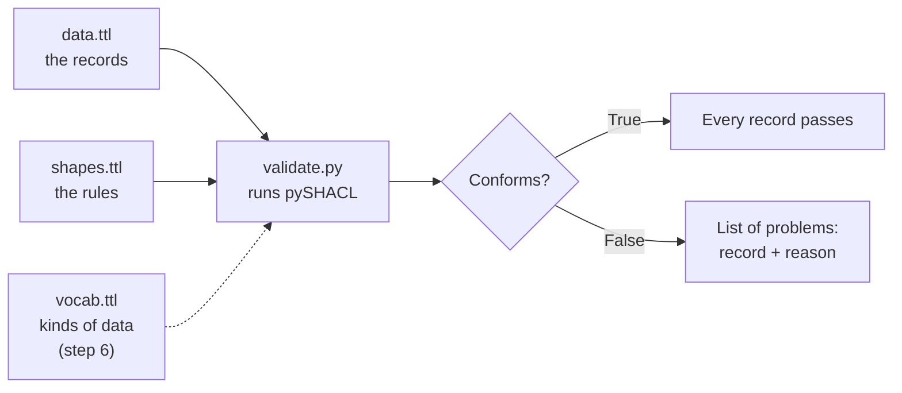
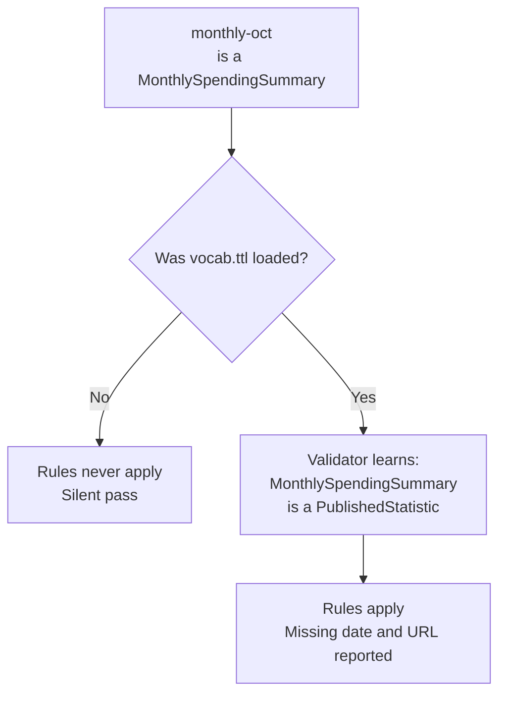
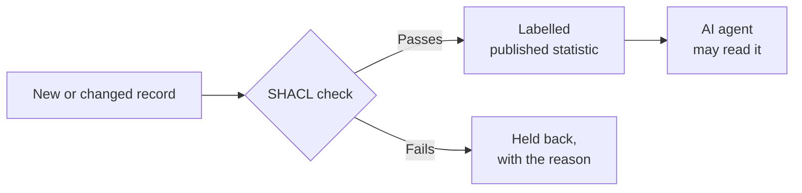

# Building Your First SHACL Shape for AI Agents

[](https://github.com/cloudbadal007/shacl-first-shape-tutorial/actions/workflows/tests.yml)

Working files for the Medium tutorial
**[Building Your First SHACL Shape for AI Agents: A Hands-On Tutorial](https://medium.com/@cloudpankaj)**.

An AI agent trusts labels. If a draft report is labelled "published statistic", an agent allowed to read published statistics will read it.

This repository shows how to **check the label first**. You write down what must be true before a record can be called a published statistic. A validator then tells you which records don't qualify, and why, in plain English.

- **Time:** about 15 minutes
- **You need:** Python 3.9 or newer
- **You don't need:** any SHACL or RDF experience

---

## Quick start

```bash
git clone https://github.com/cloudbadal007/shacl-first-shape-tutorial
cd shacl-first-shape-tutorial
pip install -r requirements.txt
cd step-4
python validate.py
```

You should see:

```
Conforms: False
- draft-q3: A published statistic needs exactly one publication date.
```

That's a working SHACL check. `draft-q3` failed because it has no publication date.

> On Windows, if `python` isn't found, use `py` instead.

---

## How a check works



Three ideas are all you need:

| Word | Meaning | In this repo |
|---|---|---|
| **Data** | Facts written as *thing, property, value* | `data.ttl` |
| **Shape** | A checklist: which records it applies to (the **target**) and what must be true (the **constraints**) | `shapes.ttl` |
| **Report** | Which records broke which rule | printed by `validate.py` |

The rules live in `shapes.ttl`, not in the Python. To change a rule, you edit the shapes file. The script stays the same.

---

## The three rules you will build

1. A published statistic has **exactly one publication date**.
2. A published statistic has **a public URL**.
3. Nothing can be **both** a published statistic **and** an internal report.

---

## Walk through the steps

Each folder holds the complete files for one step of the article, so you can compare your work at any point. Run each step from inside its folder.

| Folder | What it adds | Article section |
|---|---|---|
| [`step-4/`](step-4) | Your first shape: one rule, two records | Steps 2 to 4 |
| [`step-5/`](step-5) | Two more rules: a public URL, and "not also an internal report" | Step 5 |
| [`step-6/`](step-6) | A subcategory and the vocabulary file: the mistake almost everyone makes | Step 6 |
| [`try-it-yourself/`](try-it-yourself) | Worked answers to the article's "Try it yourself" exercises | Try it yourself |

### Step 4: one rule

```bash
cd step-4
python validate.py
```

```
Conforms: False
- draft-q3: A published statistic needs exactly one publication date.
```

`spending-2025` has a date, so it passes. `draft-q3` has none, so it fails.

### Step 5: three rules

```bash
cd step-5
python validate.py
```

```
Conforms: False
- draft-q3: A published statistic needs a public URL.
- draft-q3: A published statistic needs exactly one publication date.
- review-memo: A dataset cannot be both a published statistic and an internal report.
```

Look at `review-memo`. It has a date and a URL, so a simple "required fields" check would pass it. It still fails, because its two labels contradict each other.

### Step 6: the silent pass

A **monthly spending summary** is a kind of published statistic. The record `monthly-oct` has no date and no URL, so it should fail.

```bash
cd step-6
python validate_before_fix.py
```

```
Conforms: False
- draft-q3: A published statistic needs a public URL.
- draft-q3: A published statistic needs exactly one publication date.
- review-memo: A dataset cannot be both a published statistic and an internal report.
```

`monthly-oct` is **missing** from the list. Nothing complained. The validator never read `vocab.ttl`, so it never learned that a monthly summary is a published statistic.



The fix is one line: load the vocabulary and pass it as `ont_graph`.

```python
vocab = Graph().parse("vocab.ttl")
conforms, report, _ = validate(data, shacl_graph=shapes, ont_graph=vocab)
```

```bash
python validate.py
```

```
Conforms: False
- draft-q3: A published statistic needs a public URL.
- draft-q3: A published statistic needs exactly one publication date.
- monthly-oct: A published statistic needs a public URL.
- monthly-oct: A published statistic needs exactly one publication date.
- review-memo: A dataset cannot be both a published statistic and an internal report.
```

Now `monthly-oct` is checked like any other published statistic.

> **The lesson:** a validator that finds nothing is not the same as data that is correct. Always include a record you know is bad, and confirm it fails.

### Try it yourself: worked answers

Try the exercises on your own first. Then compare:

```bash
cd try-it-yourself
python validate.py
```

```
Conforms: False
- audit-notes: An internal report must not have a public URL.
- forecast-2027: A published statistic cannot be dated after 2026.
- travel-2025: A published statistic needs exactly one owner.
```

| Exercise | Rule added in `shapes.ttl` | Record that breaks it |
|---|---|---|
| No date later than 2026 | `sh:maxInclusive "2026-12-31"^^xsd:date` | `forecast-2027` |
| Exactly one owner | `sh:path ex:owner` with `sh:minCount 1` and `sh:maxCount 1` | `travel-2025` |
| An internal report has no public URL | a new shape for `ex:InternalReport` with `sh:maxCount 0` | `audit-notes` |

**Tip:** the date limit is written as its own rule, with its own message. If you add `sh:maxInclusive` inside the existing date rule instead, it still works, but a 2027 date is reported as "needs exactly one publication date", which is confusing.

---

## Where this fits with AI agents

The check runs **when the catalogue changes**, not on every agent request. A record that fails never gets the "published statistic" label, so an agent allowed to read published statistics never sees it.



Access controls decide **who** may read published statistics. This check makes sure "published statistic" **means** what everyone assumes it means.

---

## Check that everything works

From the repository root:

```bash
python test_outputs.py
python test_rules.py
```

| Test file | What it checks |
|---|---|
| `test_outputs.py` | Every step prints exactly the expected output: the 4 runs shown in the article, plus `try-it-yourself` |
| `test_rules.py` | Each rule on its own, one small record at a time (13 checks) |

Both run with plain Python. If you have `pytest`, `pytest` runs them too. See [TESTING.md](TESTING.md) for the full list.

`pyshacl` is pinned to **0.40.1**, the version the tutorial was tested with, so your output matches the article exactly.

---

## Files

```
shacl-first-shape-tutorial/
├── step-4/             first shape: one rule
├── step-5/             three rules
├── step-6/             the vocabulary and the silent pass
├── try-it-yourself/    worked answers to the exercises
├── test_outputs.py     outputs match the article
├── test_rules.py       each rule, one record at a time
├── TESTING.md          what every test checks
├── .github/workflows/  runs the tests on every push
└── requirements.txt    pyshacl==0.40.1
```

Inside each step folder:

| File | What it is |
|---|---|
| `data.ttl` | The records being checked, written in Turtle |
| `shapes.ttl` | The rules (the SHACL shape) |
| `vocab.ttl` | What the kinds of data are and how they relate (step 6 onward) |
| `validate.py` | Runs the check and prints each problem in plain English |
| `expected.txt` | The output you should see |

---

## Common problems

| You see | What to do |
|---|---|
| `ModuleNotFoundError: No module named 'pyshacl'` | Run `pip install -r requirements.txt` from the repository root |
| `FileNotFoundError` for `data.ttl` | Run `validate.py` from **inside** its step folder (`cd step-4` first) |
| Output slightly different from the article | Check the version with `pip show pyshacl`. It should be 0.40.1 |
| A record you expected to fail is missing | Did you load `vocab.ttl`? See [Step 6](#step-6-the-silent-pass) |

---

## Learn more

- Background: [Why Enterprise Stacks Never Adopted SHACL, and Why Agents Need It Now](https://medium.com/@cloudpankaj/why-enterprise-stacks-never-adopted-shacl-and-why-agents-need-it-now-f92ce4cb39dc)
- [OPA, Cedar or SHACL: Which One Should Check Your AI Agent's Actions?](https://medium.com/@cloudpankaj/opa-cedar-or-shacl-which-one-should-check-your-ai-agents-actions-450983485001?sk=6e3518e9d9365f6757816cd58e066738)
- [W3C SHACL specification](https://www.w3.org/TR/shacl/)
- [pySHACL](https://github.com/RDFLib/pySHACL)
- [RDF 1.1 Turtle](https://www.w3.org/TR/turtle/)

## License

MIT. See [LICENSE](LICENSE).
