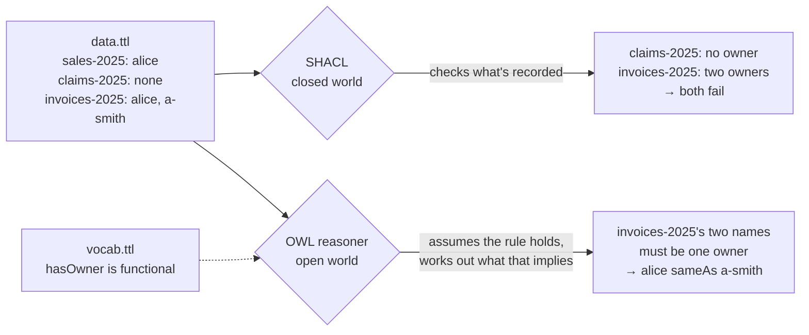
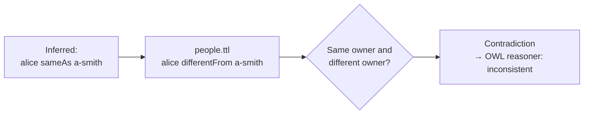

# SHACL vs OWL Reasoners: The Same Rule, Opposite Answers

Working files for the Medium article **[SHACL vs OWL Reasoners: The Same Rule, Opposite Answers](ARTICLE_URL)**.

One rule, "every dataset has exactly one owner", checked two ways:

- **SHACL** checks the data you have and reports what breaks the rule.
- **An OWL reasoner** works out what must be true if the rule holds, and only complains about a contradiction.

## How the two checks differ





Same rule, same data. SHACL tells you which records are wrong. OWL assumes the rule is true and tells you what the data must mean as a result — until an added fact makes that impossible.

## Run it

```
pip install -r requirements.txt

python shacl_check.py              # SHACL: two datasets fail
python owl_reason.py               # OWL: no errors, and alice is "the same as" a-smith
python owl_reason_different.py     # OWL: inconsistent, once you say they are different people
```

Check that every output still matches the article:

```
python test_outputs.py
```

## Files

| File | What it is |
|---|---|
| `data.ttl` | Three datasets: one owner, no owner, two owners |
| `shapes.ttl` | The rule as a SHACL shape |
| `vocab.ttl` | The rule as OWL: `hasOwner` is functional (at most one) and every dataset has at least one |
| `people.ttl` | One extra fact: alice and a-smith are different people |
| `shacl_check.py` | Runs the SHACL check |
| `owl_reason.py` | Runs an OWL 2 RL reasoner ([owlrl](https://github.com/RDFLib/OWL-RL)) and prints what it inferred |
| `owl_reason_different.py` | Same, with `people.ttl` added |

Tested with pySHACL 0.40.1 and owlrl 7.6.2 (pinned in `requirements.txt`).

## License

MIT
